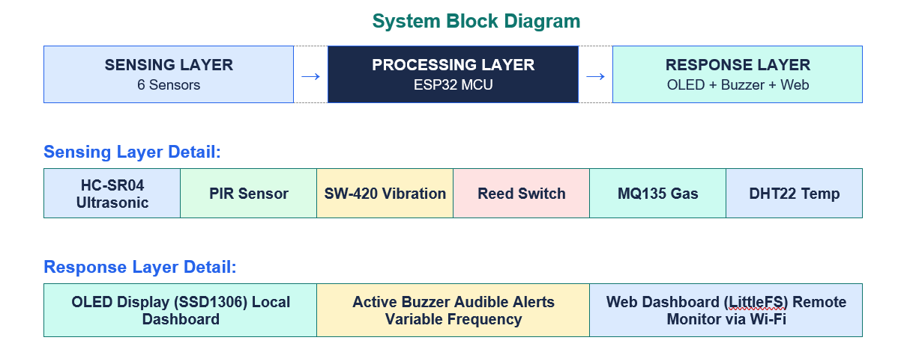
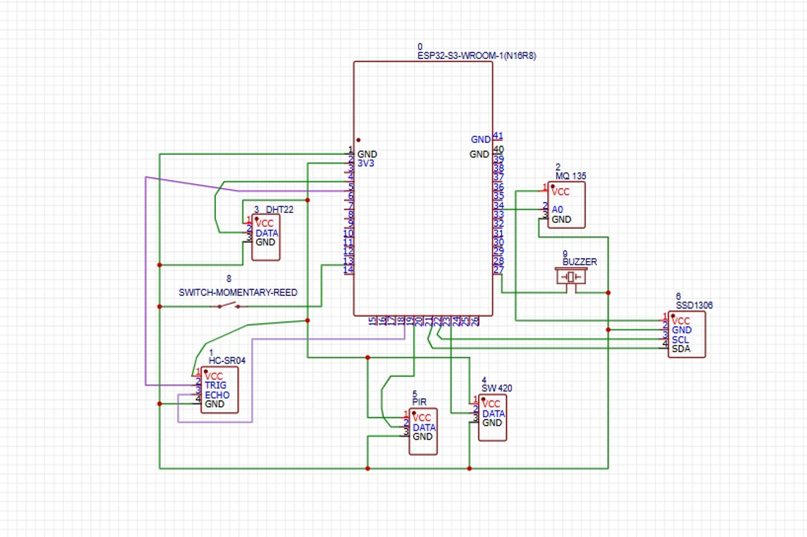

# Adaptive Risk Detection System (ADRS)

A low-cost, ESP32-based **multi-sensor risk detection system** that fuses six sensors into a single risk level (`LOW` → `MEDIUM` → `HIGH` → `CRITICAL`), alerts locally with an OLED and a variable-rate buzzer, and exposes a live **web dashboard** over Wi-Fi.

> Built as a cross-domain embedded/IoT project to explore hardware, firmware, and a lightweight web front-end end to end.

---

## Features

- **Sensor fusion, not single-sensor alarms** - risk is derived from combinations of readings (e.g. door open + vibration = forced entry; gas rise + high temperature = fire).
- **Adaptive air-quality baseline** - the MQ135 is auto-calibrated after a 10 s warm-up and can be re-baselined at runtime from the dashboard, so alerts are based on *change from ambient*, not absolute values.
- **Escalating buzzer** - beep rate increases with severity (1000 ms idle → 120 ms for fire/gas critical).
- **Local display** - SSD1306 OLED shows all live readings and current risk.
- **Self-hosted dashboard** - static HTML served from the ESP32's flash (LittleFS); polls a JSON API every 2 s. No cloud, no external server.
- **Remote controls** - silence the alarm or recalibrate the air baseline from the browser.

## System Architecture



| Layer | Components |
| --- | --- |
| Sensing | HC-SR04, PIR, SW-420, Reed switch, MQ135, DHT22 |
| Processing | ESP32 (fusion logic, Wi-Fi, web server) |
| Response | SSD1306 OLED, active buzzer, web dashboard |

## Hardware

| Component | Role | Pin (GPIO) |
| --- | --- | --- |
| HC-SR04 Ultrasonic | Proximity / distance | TRIG 5, ECHO 18 |
| PIR Sensor | Motion detection | 19 |
| Reed Switch | Door open / closed | 13 (internal pull-up) |
| SW-420 | Vibration / tamper | 23 |
| MQ135 | Air quality / gas | 34 (ADC) |
| DHT22 | Temperature | 4 |
| SSD1306 OLED (I²C) | Local display | default SDA / SCL, addr `0x3C` |
| Active Buzzer | Audible alert | 27 |

Full bill of materials with costs: [docs/components.txt](docs/components.txt) (approx. ₹1500 - ₹2000 total).

### Circuit diagram



## Risk Logic

Thresholds are defined at the top of [code/adrs.ino](code/adrs.ino). "Air delta" is the MQ135 reading minus the calibrated baseline.

| Risk | Condition | Alert reason | Buzzer interval |
| --- | --- | --- | --- |
| **CRITICAL** | Air delta > 200 **and** temp > 40 °C | Fire / gas critical | 120 ms |
| **HIGH** | Door open **and** vibration detected | Forced entry | 200 ms |
| **MEDIUM** | Object < 15 cm | Very close object | 180 ms |
| **MEDIUM** | Object < 30 cm | Object near | 400 ms |
| **MEDIUM** | Air delta > 100 | Air quality warning | 600 ms |
| **LOW** | None of the above | All clear | silent |

Vibration is only flagged after ≥ 3 hits inside a 1.5 s window to filter out single bumps.

## Web Dashboard

A single-page dashboard ([Dashboard/index.html](Dashboard/index.html)) with a live risk badge, per-sensor status cards, alert banner, and a buzzer-logic reference panel.

### HTTP API

| Method | Endpoint | Description |
| --- | --- | --- |
| `GET` | `/` | Serves the dashboard (`index.html` from LittleFS) |
| `GET` | `/api` | JSON snapshot of all sensors + risk + alert reason |
| `POST` | `/silence` | Mutes the buzzer until risk returns to `LOW` |
| `POST` | `/reset` | Re-calibrates the MQ135 air baseline |

Example `/api` response:

```json
{
  "distance": 84.2,
  "pir": false,
  "door": true,
  "vibration": false,
  "airDelta": 12,
  "temperature": 27.5,
  "risk": "LOW",
  "alert": "ALL CLEAR"
}
```

## Getting Started

**Requirements:** Arduino IDE (or PlatformIO) with ESP32 board support, plus the libraries `Adafruit GFX`, `Adafruit SSD1306`, and `DHT sensor library` (`WiFi`, `WebServer`, `LittleFS`, `Wire` ship with the ESP32 core).

1. Wire the hardware per the circuit diagram above.
2. Open [code/adrs.ino](code/adrs.ino) and set your Wi-Fi credentials (`ssid`, `password`) near the top of the file.
3. Create a `data/` folder in the sketch directory and copy `Dashboard/index.html` into it (the firmware serves `/index.html` from LittleFS).
4. Upload the filesystem image to the ESP32 using an ESP32 LittleFS upload tool.
5. Flash the sketch, open the Serial Monitor at `115200` baud, and note the printed IP address.
6. Browse to that IP from any device on the same network.

On boot the device warms up the MQ135 for 10 s and captures the air baseline - keep the sensor in clean air during this time.

## Repository Structure

```
.
├── code/
│   └── adrs.ino              # ESP32 firmware (sensors, risk logic, web server)
├── Dashboard/
│   └── index.html            # Web dashboard (served from LittleFS)
├── diagrams/
│   ├── Block_diagram.png     # System block diagram
│   └── Circuit_diaagram.png  # Wiring schematic
├── docs/
│   └── components.txt        # Bill of materials and cost
└── README.md
```

## Notes & Limitations

- Prototype-grade: thresholds are fixed constants and were not field-calibrated; the MQ135 gives a relative air-quality indication, not calibrated gas concentrations.
- The device must be on the same local network as the viewer; there is no authentication on the API, so it is not intended for exposure to the internet.
- Credentials in the sketch are placeholders - replace with your own and avoid committing real ones.

## Possible Future Work

- Move Wi-Fi credentials out of source (WiFiManager / `secrets.h`)
- Event logging and history charts on the dashboard
- Push notifications (MQTT / Telegram) on `HIGH` / `CRITICAL`
- Self-adjusting thresholds based on learned ambient conditions

## Author

**Prashast Awasthi** - [GitHub](https://github.com/awasthiprashast)
